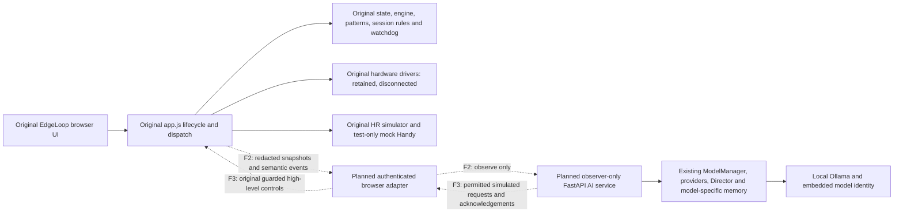

# Architecture pivot and provisional comparison

## Decision and current status

Use original EdgeLoop 1.1.3 as the application's control baseline. F1 preserves its 85 original files byte-for-byte and adds only provenance, validation/launch helpers and these records. F1 browser acceptance is blocked by this sandbox. **F2–F4 are planned, not implemented.** The custom B2a project remains intact; no final migration or end-to-end success is claimed.

Original `app.js`, not the AI service, owns elapsed session time, calibration, game/mode transitions, effective HR ceilings, watchdog/recovery and `dispatchHardware`. Existing B1/B2a engines must not be started by the observer service. AI outage never swaps controllers, stops the original session by implication or replays queued commands on reconnection.

## Smallest integration seam identified

Keep the UI unchanged until the original baseline passes host browser validation. Then add an optional companion module plus a small explicit hook within original `app.js`, close to `syncTelemetry()` and its guarded session/control helpers. Preserve module imports/calculations/drivers rather than duplicating them in Python. A few explicit high-level exports are easier to merge and audit than DOM clicks, monkey patches or a new engine.

Two concrete upstream hazards require dedicated tests:

1. The existing `syncTelemetry()` payload includes `chosenTargetSeconds` and raw `history`. **Do not forward it wholesale.** Build a separate allowlisted AI snapshot from original state: session status/phase, visible elapsed time, mode/goal, measured HR/trend/quality, effective limit/pullback, edges, intensity, visible movement, device readiness and recent semantic events. Exclude Mystery targets/windows that reveal them, private settings, keys and raw history.
2. The original service worker caches successful GET responses and can match same-origin cache entries with `ignoreSearch`. Before adding AI/auth endpoints, explicitly bypass their paths/origin in the service worker and use `Cache-Control: no-store`. Never put bridge credentials in query strings or cache pairing/status/chat responses.

Original `SESSION_STATE: RUNNING` peer handling can start an idle session, and several peer commands can reset or invoke special actions. **Do not expose that generic peer-command interface to an LLM.** A restricted adapter must require PAUSED for resume, actual simulated-only readiness with no physical drivers, fresh source/guard readiness and explicit authorization. It then calls original `startOrResumeSession`, `pauseSession`, `stopSession`, the selected mode path or validated intensity path, never `dispatchHardware` or Handy directly. Patterns/modes and goals are distinct; calibration and special actions are excluded.

## Planned bridge v1 contract

This contract is a design specification; no endpoint implements it in F1.

- Authenticate an explicit user-enabled pairing with a high-entropy, expiring, memory-only token bound to an exact allowed localhost origin and browser instance. Bind the service to loopback; validate Host and HTTP/WebSocket Origin. Restrict CORS to configured origins, methods and headers; no wildcard credentials. WebSocket authentication must complete before other frames are processed, with a short deadline and bounded unauthenticated input. Do not expose Ollama directly to browser origins.
- Include `protocol_version`, browser-instance ID, actual-session ID, connection epoch, monotonically increasing observation sequence and bounded compact state. Send semantic events plus periodic compact snapshots; rate-limit/coalesce observations before model dispatch. Starting a new actual EdgeLoop session changes session identity; model selection does not.
- A command includes ID, connection epoch, actual-session identity, expected safety revision, operation, validated arguments and a deadline. The browser deduplicates IDs and rechecks authorization/fake-device status/guard readiness immediately before application. Stop and safety changes invalidate pending requests and approval tokens. A broker acknowledgement alone is not evidence of execution.
- Report `requested`, `accepted`, `applied`, `rejected` and `unconfirmed` distinctly. `applied` includes the actual resulting redacted state. Full Stop can have zero movement in a running session; output alone cannot prove success. Timeout/disconnect yields unconfirmed, with no automatic retry of mutating commands. Reconnection gets a new epoch, fresh state and new authorization; old requests/approvals never survive it.
- Initially allow only read state/list patterns, approved mode/pattern changes, bounded intensity, pause, paused-session resume and stop in simulation. No new-session start, calibration, configuration/travel/safety changes, emergency reset, Came Early or Force Orgasm tools. The browser rejects a request if any physical driver is connected. Backend text and telemetry values never become controller instructions.

## Comparison

| Dimension | A: custom Python/Node implementation at B2a | B: original fork plus planned AI adapter |
|---|---|---|
| Functional parity | Tested HR and Classic subset; calibration, other live experiences, goals, outcome logic and real drivers still require integration | Original complete source retained from the pin; original unit tests pass. Local browser parity remains unverified here |
| Duplicated code | Python facade plus custom Node lifecycle reproducing `app.js`; repeated session and device integration work | Original lifecycle/calculations/drivers remain one implementation; adapter contains observation, consent and request routing only |
| Maintenance | Custom orchestration must track every upstream safety/game change | Merge upstream into a genuine descendant checkout; constrain modifications to a small hook/module and optional panel |
| Hardware complexity | New headless driver ownership, browser BLE bridge, leases and verified-stop orchestration still needed | Existing original browser drivers remain authoritative; simulator-only AI boundary still needs proof before any physical phase |
| Safety boundary | Bounded Node protocol, strict schemas, epochs/faults, typed snapshots, 221 passing application regressions | Original safety remains local to the browser; authenticated request/deadline/replay/stop rules must be built and tested without creating another engine |
| AI modularity | Working providers, model switch, Director, streaming and isolated memory; currently wired into a custom app factory | Reuse those classes in an observer-only factory; tool schema/gateway compatibility needs a narrow adaptation |
| Validation | 221 backend tests plus original suites; historical browser restrictions | Original `npm test` passes; per-file original tests and source hashes checked. Bridge, model/session continuity and browser E2E acceptance are not yet complete |
| Remaining effort | Finish reimplementation B2b/B3/B4, then hardware/UI integration | F1 host browser gate, F2 optional telemetry/chat, F3 restricted commands and F4 demonstration; original features no longer need to be rebuilt |

**Provisional recommendation:** continue with B for fidelity and lower long-term duplication. Keep A as a tested reference and source of reusable AI modules. Finalize the migration only after F4 demonstrates full original behavior without AI, model swaps during a live simulated session, contextual conversation/Director events, explicitly authorized adjustments, execution acknowledgements, original Stop precedence and AI disconnect/reconnect without stale commands. No physical-safety claim follows from unit tests or fake hardware.
