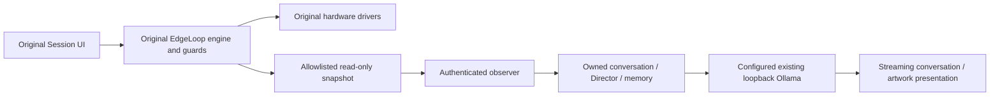

# F2.2 — one authoritative application

Subsequent live validation on the existing 11435 server is complete; see [F2.2 live acceptance](F22_LIVE_VALIDATION.md). Earlier availability records below describe their original test time.

The primary application is `/home/sean/projects/edgeloop-ai-fork/`. Its original
EdgeLoop browser engine remains the only session/hardware controller. The AI is
read-only. The three-column UI, pairing, memory, thinking controls and artwork
presentation remain integrated.

## Source comparison and checkpoints

| Area | Legacy `edgeloop-ai` | Primary fork after F2.2 |
|---|---|---|
| Git baseline | `master`, `9e89fa1`; modified Evelyn source plus untracked character work | `experiment/ai-companion`, descended from `965727f` including fixes after the cited F2.1 `5145b57` |
| Session/hardware ownership | Custom Python/Node coordinator and old dashboard | Original EdgeLoop 1.1.3 browser engine/drivers only |
| AI imports | Separate application package via injected PYTHONPATH and legacy venv | Installed `companion_ai` and `ai_observer` packages in a fork-owned venv |
| Character development | New uncommitted Modelfiles, lore, scripts and benchmarks | Selected source/evidence copied with hashes; original files retained |
| Ollama configuration | Historical default 11434 with separate manual 11435 experiments | Explicit TOML configuration, environment override, displayed endpoint and read-only diagnostics |
| Models/weights | Two external stores, three old tags and 17 character tags | Existing stores reused; no weights copied and no tags rebuilt/deleted |

Backups precede changes: `backup/f22-pre-consolidation-20261027` preserves the
fork tip; `refs/backup/f22-legacy-master-20261027` preserves the legacy committed
tip inside the fork object database. No histories were merged. Both Git bundles,
legacy working diff/status and a source/working-file archive are under
`/home/sean/Work/backups/edgeloop-f22-20261027/`. Model weights and environments
were excluded from that archive. A hash inventory preserves the uncommitted
source state, and a separate inventory records both model stores.

Connectivity repair is checkpoint `39dcbc6`; see [exact diagnosis](F22_CONNECTIVITY.md).
The later consolidation checkpoint contains the self-contained runtime and
validation recorded in [validation-f22.json](validation-f22.json).

## Migrated and retained source

| Source | Fork location | Adaptation |
|---|---|---|
| Ollama transport | `companion_ai/llm.py` | Streaming, capability discovery, exact embedded SYSTEM preservation, private reasoning counts and explicit modern thinking controls |
| Model manager/conversation | `companion_ai/conversation.py` | Text-only lifecycle, bounded recovery, per-model memory; remove tool execution and synthetic simulator replies; avoid evicting models belonging to external users |
| Conversation Director | `companion_ai/director.py` | Existing policy, provenance, topic/repetition/silence handling; no new persona |
| Context budgeting | `companion_ai/context.py` | Retain context budgets and history protection; replace old tool-execution advice with neutral read-only runtime instructions |
| AI schemas | `companion_ai/models.py` | Extract AIConfig, MemoryConfig, SpeechPolicy, ModelSelection and strict base only |
| Settings/resources | `companion_ai/storage.py`, `diagnostics.py` | Atomic settings and read-only inference/resource metrics |
| Character definitions/lore | `characters/models/`, `lore/`, `build/generated/`, `archive/` | Exact source bytes, including uncommitted development work and the separately retained lite-v1 definition |
| Builders | `tools/characters/build_character*.py` | Fork-owned paths and central endpoint config; creation remains an explicit operator action and was not invoked |
| Direct comparison benchmark | `tools/characters/compare_evelyn_lite.py` | Central endpoint config; no dependency on the old application |
| Character experiment evidence | `docs/fork/character-evidence/` | Archived reports and decisions; no candidate promotion or Modelfile editing |
| Relevant regression assertions | `tests/ai/` | Provider, identity, Director, history, context and reasoning cases; data-only BrowserObservation fixture replaces the legacy engine fixture |

Exact source/destination hashes and adaptation notes are in
[f22/migration-sources.json](f22/migration-sources.json). The source code remains
AGPL-3.0-only; original notices and the upstream pin remain intact. Corresponding
migrated source is now distributed inside this repository rather than requiring
the old checkout. See [NOTICE_FORK.md](../../NOTICE_FORK.md).

Deliberately excluded: the old `app.py`, `core.py`, session/coordinator/engine and
hardware bridges, `tools.py` executor/control policy, redundant dashboards,
audio/voice services, old runtime personality/profile API, reference vendor engine,
OS/service setup, private data, model weights, and unrelated Character_Art images.
The old dashboard harness and full old backend suite were run read-only as
regression baselines; they are not runtime dependencies of the new application.

## Runtime and configuration

`config/ai.toml` defaults to `http://127.0.0.1:11435`.
`EDGELOOP_OLLAMA_URL` overrides that setting before observer construction.
`EDGELOOP_AI_CONFIG` can select a different TOML file. Only loopback HTTP origins
without credentials, API paths, query strings or fragments are accepted.
The observer passes the resolved origin explicitly to ModelManager, which passes
it to every provider request. There is no discovery fallback to another server.
The UI labels the observer WebSocket separately and displays the Ollama origin.
No URL-setting message or arbitrary command route was added to the closed protocol.

The Python package is installed editable from the fork using declared dependencies.
`serve-ai.sh` uses its own `.venv/bin/python -I`, ignoring injected Python paths.
It has no reference to the legacy checkout. From another working directory it
still resolves this fork's installed packages/config. Neither launcher starts an
Ollama daemon or kills another process. Occupied UI/observer ports fail with an
actionable explanation. `--check` and `ollama-status.sh` inspect existing servers.

Model settings and memory are keyed by provider, endpoint and exact model identifier.
Existing unscoped model presets remain readable as a compatibility fallback;
new writes are scoped. Existing private files are not deleted or copied from the
legacy application. Old persisted memories without an endpoint are not silently
assigned across servers; associate/import them explicitly if needed. This fork's
pre-migration data contained no persisted memory files. In-process model switching
retains conversation histories and is independent of original session state.

Selecting or closing this client does not force-unload another application's
models or terminate an Ollama server. Residency is left to the existing runtime
and each request's keep_alive. Ready in the UI means a confirmed selection, not
verified GPU residency. Model weights are never downloaded or rebuilt by startup.

## Character and thinking compatibility

The existing provider keeps the selected Modelfile SYSTEM verbatim, once, before
neutral runtime context. No character/profile/style prompt is supplied by the app.
Qwen3 and Qwen3.5 requests use native thinking controls discovered through `/api/show`.
Explicit `thinking.values` takes precedence over a generic capability flag;
models that cannot disable thinking reject Off, and non-thinking models default
to Off. The existing Boolean toggle remains honest and capability-aware.
See [Ollama thinking controls](https://docs.ollama.com/capabilities/thinking).

Only `message.content` enters visible token streaming and conversation memory.
`message.thinking` is counted in diagnostics without retaining or displaying its
text. Reasoning-only output gets one bounded retry within the same deadline,
then a clear no-visible-response error. There is no silent switch to non-thinking
mode or fake reply. Native tool calls are rejected by the text-only collector;
there is no executor or session-control schema in the companion package.
The native Qwen3.5 renderer/template is not rewritten; see
[Ollama v0.33.3 Qwen3.5 renderer](https://github.com/ollama/ollama/blob/v0.33.3/model/renderers/qwen35.go).

The six notable newer model identifiers map to display names/placeholders in
`src/js/ai/artwork-manifest.js`. Presentation components remain generic. Unknown
models retain safe default artwork. No artwork generation or emotion classifier
was introduced, and physiology is not used to infer emotions.

## Validation and current host state

The original 1057 tests in 32 files pass. The unchanged legacy backend's 221 tests
and its dashboard harness pass. The consolidated Python suites, bridge/presentation
suites and Chromium acceptance pass; exact counts and reports are in the validation
JSON. Browser acceptance uses the 17-name character inventory, mocked Ollama/Handy,
denied native permissions, model switching/memory, unavailable-Ollama guards,
authoritative telemetry, session lifecycle, cancellation and desktop/mobile layouts.
Screenshots were visually reviewed, including 375×667.

Real observer streaming and memory restoration passed with the already running
11434 server for Mira and Evelyn using synthetic IDLE/98 BPM observations. The
requested 11435 smoke was attempted but returned connection refused: no listener
was present at diagnosis or at that check. Its 17 installed manifests are intact.
No 11435 daemon was started without approval. This is a live availability limitation,
not a passing claim for newer-model inference or a reason to fall back silently.
See [developer workflow](DEVELOPMENT.md) to inspect/start the intended existing
runtime manually and repeat the explicit smoke test. No physical device was tested.
