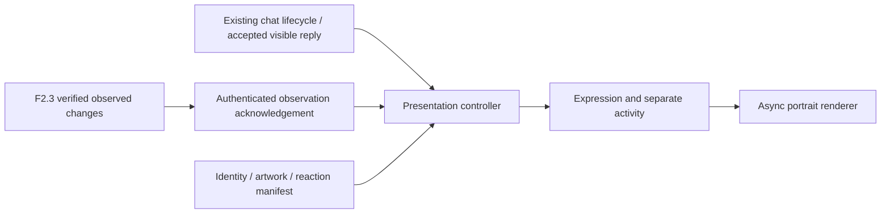

# F2.4 — character artwork and expressions

F2.4 connects the existing companion UI to the user’s high-resolution Evelyn and
Daisy portraits. The original engine, device drivers, character Modelfiles,
conversation memory and F2.3 canonical telemetry remain authoritative and unchanged.
AI and character presentation remain read-only; no voice or F3 control is added.

See the [artwork inventory and missing variants](F24_ARTWORK_INVENTORY.md),
[shared manifest](../../src/assets/characters/manifest.json) and
[validation evidence](validation-f24.json).

## Identity and configuration

`src/assets/characters/manifest.json` is the single configurable contract:

- `models`: exact Ollama identifier → canonical visual character ID.
- `characters`: ID → display name, contain/cover fit, object position and expression assets.
- `expressions`: twelve standard IDs; null asset entries explicitly request neutral fallback.
- `activities`: idle, thinking, listening, speaking and disconnected, independent of expression.
- `presentation`: session reaction map, six-second reaction cooldown and eight-second chat priority hold.

All 15 installed character aliases map explicitly to Evelyn or Daisy. The two base
models and unknown tags remain generic. No prefix/name guessing is used. A new alias
or image needs a manifest edit and page refresh, not presentation-code edits or an
Ollama rebuild. The identity map does not merge model-specific conversation stores.
Switching between models of one character retains the portrait DOM node unless
restored dialogue implies a different expression. Changing character clears the
old portrait immediately and fences pending image loads.

`tools/serve_local.py` exposes only originals referenced by this manifest. Archive
images, the PNG named README.md, directories, private AI data and symlink escapes
remain unavailable. JPEG, PNG and WebP references are supported. The browser handles
native decoding and alpha; originals are not copied or transformed. If deploying
through another server, reproduce the exact allowlist and check distribution rights.

## Independent presentation controller



`presentation-controller.js` imports no session controller, driver, memory store or
Ollama client. It reads no HR, speed or physiological field. There are no new inbound
protocol variants. An accepted observation acknowledgement includes up to sixteen
`events: [{id, kind, session_id}]`, taken only from `accepted_event_ids`. Event kinds
and transitions were already validated by F2.3. Rejected, unsupported, duplicate or
out-of-epoch observations cannot create these reactions. The original protocol,
authentication, origins, limits and authoritative data schema are retained.

Starting a user turn depicts Attentive while activity becomes Generating. Only an
accepted completed visible reply can choose a dialogue expression; streaming tokens
and internal reasoning do not. Completion returns activity to Idle while retaining
the chosen expression. Cancel/error/disconnect invalidates the request. Model/request
IDs and a bounded set of cancelled IDs reject stale starts and completions. Reconnect
resets presentation sequence evidence. Restoring history inspects the last accepted
assistant reply from the existing model store; it creates no second memory system.
A quiet/suppressed turn resets activity without inventing an expression.

The lightweight dialogue mapper recognizes specific first-person self-expression
and stage direction, for example “I smile warmly”, “I give you a playful wink”,
“I pause thoughtfully” or “I’m beaming”. It rejects ambiguous multiple cues, quoted
examples, fenced code and thinking blocks. It does not switch on isolated words
such as happy, excited or worried, and never reads the user message to classify
emotion. Unknown tone retains the prior appropriate expression. No classification
inference call, prompt instruction, Modelfile change or invented emotional metadata
is used. An optional bounded explicit expression argument is available to future
presentation adapters, not an AI tool or a new accepted wire command.

This is intentionally limited English phrase recognition, not a general emotion
classifier. It can miss paraphrases, and text can describe fictional gestures or
hypotheticals. It depicts the character, never establishes a user emotion or a real
physiological fact. F2.3’s remaining language inaccuracies are not solved by artwork.

## Priority and event reactions

- A verified Stop cancels an active visual generation and depicts Neutral immediately.
- An active chat or its eight-second hold takes priority over routine session reactions.
- Other reactions require a six-second cooldown; suppressed reactions are dropped,
  not queued for later narration. Up to 128 event IDs deduplicate repeated frames.
- Defaults: start/pause/resume → Attentive; milestone → Cheerful; stop → Neutral.
- An empty `presentation.session_reactions` object disables session-expression reactions.
- High BPM, source changes, signal faults and edge counts do not classify emotion.

These are character depictions, not interpretations of the user. Listening/Speaking
are dormant explicit activity indicators for future audio integration; F2.4 performs
neither. Disconnect shows a static indicator and retains artwork without animation.
The original warnings and Emergency stop remain above the tablet overlay and visible
in every mobile view. No expression callback can operate a device or stop a session.

## Rendering and performance

The right column retains the existing approximately 33% desktop allocation, alongside
27% session controls and 40% chat. Portraits use `object-fit: contain` and centered
placement; optional cover/position is manifest-controlled. Full poses, faces and
transparent backgrounds are preserved without stretching. Twelve expression states
are supported, with seven curated source images per character and explicit fallback
status for the other five.

Only the requested image is loaded, with neutral retried on failure. The renderer
has at most two DOM image layers during a 250ms crossfade and one pending image
reference; stale revisions cannot attach after a switch. It does not preload or
retain a decoded cache of all variants. Browser HTTP/decoded caches remain browser
controlled. Asset work uses asynchronous decoding and is never awaited by streaming
or control paths. Same-source activity/expression changes reuse the loaded node.
`prefers-reduced-motion` disables transitions. Images fail into a styled placeholder,
never an attached broken-image icon. Portrait originals bypass service-worker asset
accumulation; code and the small manifest remain precached and AI/auth exclusions
are unchanged.

On tablet, Character remains a collapsible side panel; mobile retains Session/Chat/
Character views. The chat composer and original session transport remain separate
from artwork. Portrait aspect differences can produce intentional dark borders;
consistent placement cannot eliminate differences already present in the originals.

## Development preview and tests

Open `http://127.0.0.1:8770/?characterPreview=1` and expand **Artwork preview ·
development** in Character. Choose either character, any of twelve expressions and
one of five activities. This is localhost-only and opt-in. It does not select an AI
model, send a message, connect hardware or alter stored history. **Return to
conversation** restores the live presentation state. It is absent from normal UI.

```bash
node --test tests/fork/bridge.test.mjs tests/fork/presentation.test.mjs
.venv/bin/python -m pytest -q tests/ai tests/fork
CHARACTER_BROWSER_REPORT=/tmp/f24-portraits node tests/fork/character-browser.mjs
FORK_BROWSER_PORT=8790 FORK_OBSERVER_PORT=8798 \
  FORK_BROWSER_REPORT=/tmp/f24-dashboard node tests/fork/browser.mjs
EDGELOOP_LIVE_ACCEPTANCE=1 LIVE_ACCEPTANCE_REPORT=/tmp/f24-live \
  node tests/fork/live-acceptance.mjs
```

Dedicated browser tests use real original images, mocked Ollama and intercepted
Handy HTTP. They cover all 24 character/expression combinations, image failures,
stale loads, cancellation, history restoration, same-character reuse, unknown
models, reduced motion, responsive screenshots and original Emergency stop. Pure
controller tests cover switching during generation, cancelled starts/completions,
connection epochs, bounded cooldowns, disabled reactions and no HR inference.
Backend tests cover exact asset allowlisting and proof/deduplication in event ACKs.
The existing dashboard and full upstream tests also remain required.

Live acceptance uses the existing 11435 server sequentially for all three requested
models. It records native SYSTEM preservation, no reasoning text, selected character,
final expression/activity and source image. A short user-requested self-description
is a test conversation, never an application persona prompt. No extra classifier
inference is made. Conservative unrecognized tones retaining Attentive are valid;
this smoke is not an expression-accuracy benchmark. No Ollama daemon is restarted,
model weights rebuilt or physical device tested.
